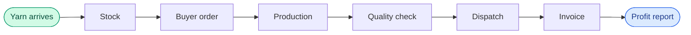
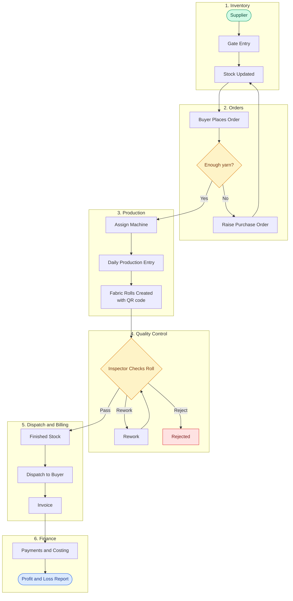
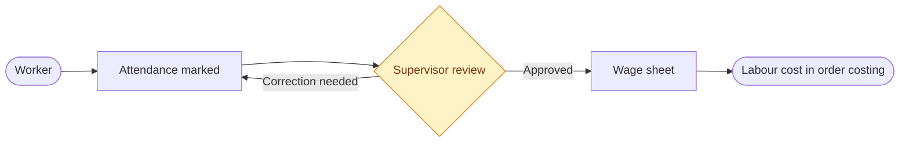
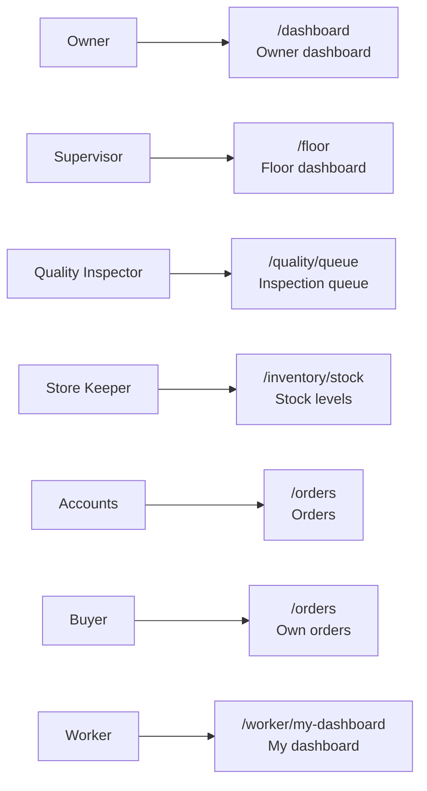
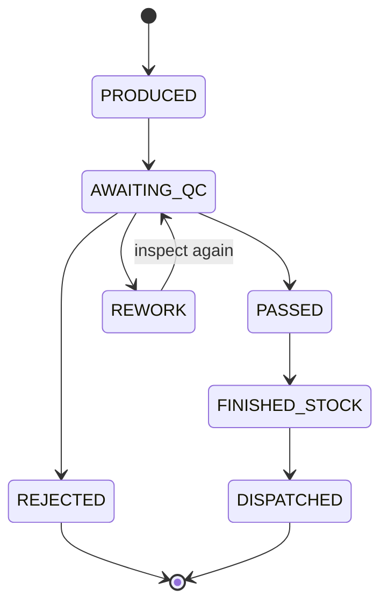
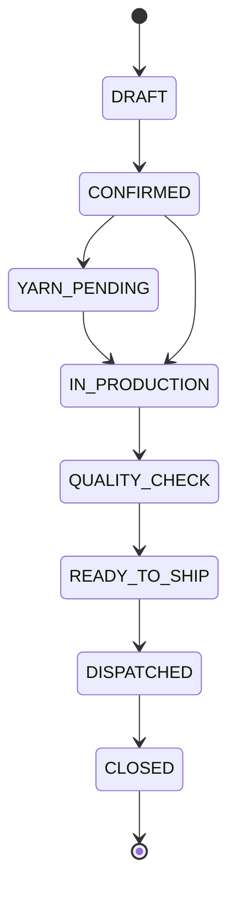
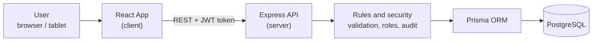

# Everest Textile Mills ERP

A web application that runs a textile mill from one place: **yarn in, fabric out, money tracked**.

It replaces notebooks, paper inspection slips, phone calls and attendance registers with one connected system.

---

## The Problem

Everest Textile Mills used to manage everything by hand:

| Before | Problem |
|---|---|
| Yarn stock in a notebook | Material runs out unexpectedly |
| Walking the floor to check machines | Idle machines, late orders |
| Paper quality slips | Defects are hard to trace |
| Phone calls to buyers | No clear order status |
| Attendance register | Wage errors |

## The Solution

One system where every step is recorded, linked and visible, from the day yarn arrives until the invoice is paid.



---

## Features

| Module | What it does |
|---|---|
| **Inventory** | Suppliers, gate entry (goods receipt), live stock levels, low-stock alerts, purchase orders |
| **Orders** | Buyer management, create and track orders, yarn availability check |
| **Production** | Machine board, daily production entry, downtime and breakdown log |
| **Quality** | Inspection queue, Pass / Rework / Reject decisions, defect report |
| **Dispatch** | Finished-goods stock, dispatch creation, invoices |
| **HR** | Workers, attendance, wage sheet, worker dashboards |
| **Finance** | Order costing, monthly profit and loss |
| **Dashboards** | Owner dashboard, floor dashboard, end-of-day (EOD) report |
| **Order Tracking** | Public page where a buyer checks order status with the order number |
| **Settings** | Mill details, master data, user management, notifications |
| **Exports** | Download reports as PDF or Excel |
| **QR codes** | QR labels for fabric rolls |

---

## Main Workflow



### Workers and wages (runs alongside)



---

## Who Uses It

Each person logs in and lands on the page for their job.



Wages, costing, profit and loss, and settings are **internal only**. The Buyer role is blocked from them and sent to a 403 page.

---

## Fabric Roll Life Cycle

Every roll follows fixed rules. A rejected roll can never be dispatched, and a reworked roll must be inspected again.



## Order Life Cycle



An order can also be moved to `CANCELLED` from any stage before dispatch.

---

## How It Is Built



| Layer | Technology |
|---|---|
| Frontend | React 19, Vite, Tailwind CSS, React Router, TanStack Query, Axios, Recharts |
| Forms and validation | React Hook Form, Zod |
| Exports and QR | jsPDF, xlsx, react-qr-code (client), qrcode (server) |
| Backend | Node.js, Express |
| Database | PostgreSQL with Prisma |
| Security | JWT login, role-based access, bcrypt password hashing, Helmet, rate limiting, input sanitising, audit log |

### What the backend enforces

- **Login and roles:** 7 roles (owner, store, supervisor, inspector, accounts, buyer, worker).
- **Status rules:** orders, machines, rolls and purchase orders can only move through allowed steps.
- **Stock rules:** stock changes are recorded as movements, never silently overwritten.
- **Business rules:** checks for inventory, orders, quality, dispatch, attendance and money.
- **Audit log:** important actions are recorded.

---

## Project Structure

```
TextileManagement/
├── client/                    React frontend
│   └── src/
│       ├── features/          one folder per module
│       │   ├── dashboard/     owner, floor, end-of-day
│       │   ├── inventory/     stock, suppliers, gate entry, POs
│       │   ├── orders/        orders, buyers
│       │   ├── production/    machine board, entry, downtime
│       │   ├── quality/       inspection queue, defects
│       │   ├── dispatch/      finished stock, dispatch, invoices
│       │   ├── hr/            workers, attendance, wages
│       │   ├── finance/       costing, profit and loss
│       │   ├── tracking/      public order tracking
│       │   └── settings/      mill, master data, users
│       ├── components/        shared layout and UI pieces
│       ├── services/          API calls
│       └── context/           login state
└── server/                    Express backend
    ├── prisma/                database schema, migrations, seed data
    └── src/
        ├── routes/            API endpoints
        ├── controllers/       request handlers
        ├── services/          business logic
        ├── middleware/        auth, security, errors
        ├── validators/        input checks
        └── utils/             business rules, status lifecycles, stock manager, QR, audit
```

---

## Run It Locally

**You need:** Node.js 18+, PostgreSQL 14+.

### 1. Backend

```bash
cd server
npm install
cp .env.example .env        # then set DATABASE_URL and JWT_SECRET
npm run prisma:generate
npm run prisma:migrate
npm run prisma:seed
npm run dev                 # runs on http://localhost:5000
```

### 2. Frontend

```bash
cd client
cp .env.example .env        # VITE_API_URL=http://localhost:5000/api
npm install
npm run dev                 # runs on http://localhost:5173
```

### Demo logins

The seed script creates one user per role. All use the password `Admin@123`.

| Role | Email |
|---|---|
| Owner | owner@textile.com |
| Store Keeper | store@textile.com |
| Supervisor | supervisor@textile.com |
| Inspector | inspector@textile.com |
| Accounts | accounts@textile.com |
| Buyer | buyer@textile.com |
| Worker | worker@textile.com |

Change these passwords before any real use.

---

## Demo Walkthrough

A suggested order for the presentation video:

| Step | Page | What to show |
|---|---|---|
| 1 | Home page, then Login | Landing page and role-based login |
| 2 | Owner dashboard (`/dashboard`) | Revenue, orders, production and quality at a glance |
| 3 | Inventory (`/inventory/stock`, `/inventory/gate-entries`) | Yarn stock, a new gate entry, low-stock warning |
| 4 | Orders (`/orders`) | Create a buyer order and check yarn availability |
| 5 | Machine board (`/production/machines`) | Which machine runs which order |
| 6 | Production entry and downtime | Daily output, breakdown log |
| 7 | Inspection queue (`/quality/queue`) | Pass, Rework or Reject a roll |
| 8 | Dispatch and invoices (`/dispatch`, `/invoices`) | Send passed rolls, generate the invoice |
| 9 | HR (`/hr/attendance`, `/hr/wages`) | Attendance and the wage sheet |
| 10 | Finance (`/finance/costing`, `/finance/pnl`) | Order cost, profit and loss |
| 11 | Public tracking (`/track`) | Buyer checks order status with no login |

---

## Current Status

| Area | Status |
|---|---|
| Frontend screens for all modules | Built |
| Login, roles, protected routes | Built |
| Backend business rules, status lifecycles, security middleware | Built |
| Database schema and migrations | Built |
| Backend test scripts (`server/test-*.js`) | Written for orders, stock, quality, dispatch, HR and security |
| Some screens (inventory, machine board, dashboards) | Still show sample data until fully connected to the live API |
| Planned next | Connect every screen to live data, face and RFID attendance, machine sensors, AI defect detection, buyer notifications |

---

## License

MIT
